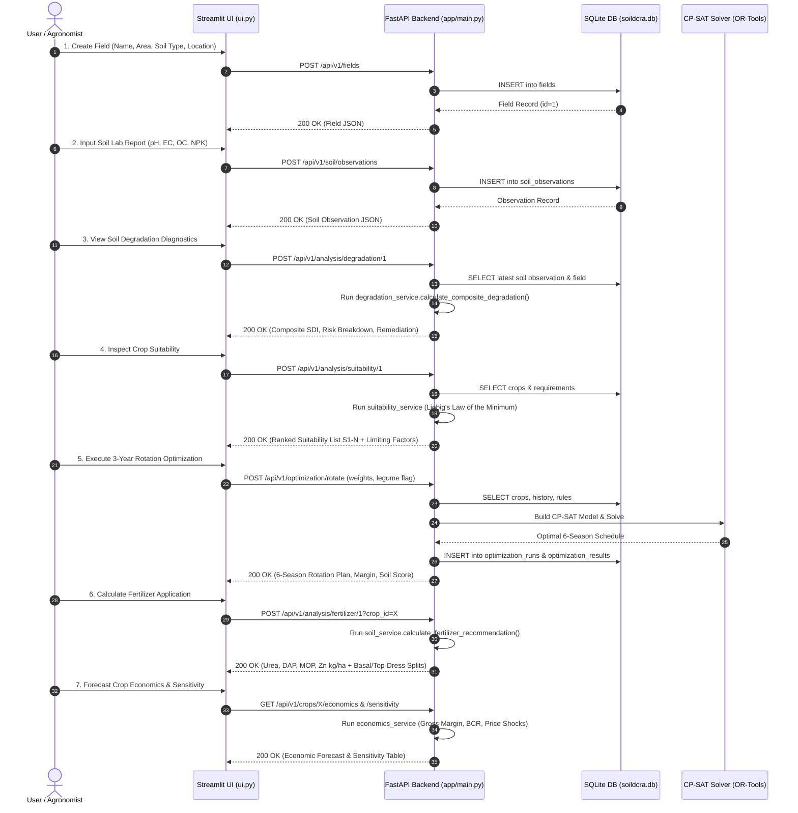
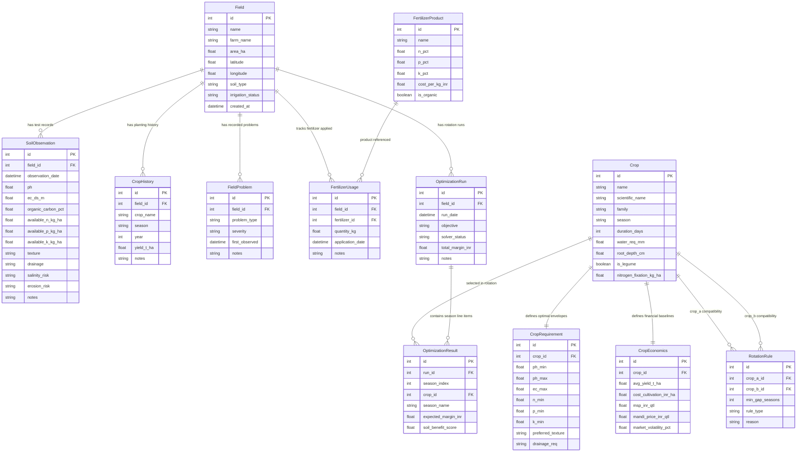

# SoilDCRA — Architecture, Codebase & Systems Engineering Context

> **Technical Audit & System Documentation**  
> **Repository:** `SoilDCRA` (Soil Degradation & Crop Rotation Assistant)  
> **Audit Status:** Complete & Verified  
> **Audited Version:** 1.0.0 (Production Core + Streamlit Frontend + REST Backend)  
> **Target Audience:** Senior Software Architects, Systems Engineers, and Autonomous AI Coding Agents

---

## Table of Contents
1. [Repository Structure](#1-repository-structure)
2. [Project Overview](#2-project-overview)
3. [Complete File-by-File Analysis](#3-complete-file-by-file-analysis)
4. [Dependency Analysis](#4-dependency-analysis)
5. [Application Architecture](#5-application-architecture)
6. [Data Flow](#6-data-flow)
7. [Database Analysis](#7-database-analysis)
8. [API Analysis](#8-api-analysis)
9. [Frontend Analysis](#9-frontend-analysis)
10. [Backend Analysis](#10-backend-analysis)
11. [Authentication & Security](#11-authentication--security)
12. [Error Handling](#12-error-handling)
13. [Testing](#13-testing)
14. [Performance](#14-performance)
15. [Code Quality](#15-code-quality)
16. [Technical Debt](#16-technical-debt)
17. [Current State](#17-current-state)
18. [Important Constraints](#18-important-constraints)
19. [Recommended Improvements](#19-recommended-improvements)
20. [Final Project Summary & Context for Future AI Agents](#20-final-project-summary--context-for-future-ai-agents)

---

## 1. Repository Structure

### 1.1 Complete Directory Tree
```text
SoilDCRA/
├── app/
│   ├── __init__.py
│   ├── main.py
│   ├── api/
│   │   ├── __init__.py
│   │   └── v1/
│   │       ├── __init__.py
│   │       ├── analysis.py
│   │       ├── fields.py
│   │       ├── optimization.py
│   │       └── soil.py
│   ├── core/
│   │   ├── __init__.py
│   │   └── config.py
│   ├── data/
│   │   ├── __init__.py
│   │   ├── crop_data.py
│   │   └── seed.py
│   ├── db/
│   │   ├── __init__.py
│   │   ├── database.py
│   │   └── models.py
│   ├── optimization/
│   │   ├── __init__.py
│   │   └── rotation_optimizer.py
│   ├── schemas/
│   │   ├── __init__.py
│   │   ├── crop.py
│   │   ├── optimization.py
│   │   └── soil.py
│   └── services/
│       ├── __init__.py
│       ├── degradation_service.py
│       ├── economics_service.py
│       ├── soil_service.py
│       └── suitability_service.py
├── tests/
│   ├── __init__.py
│   ├── smoke_test.py
│   ├── test_optimizer.py
│   ├── test_soil.py
│   ├── test_suitability.py
│   └── test_ui_contrast.py
├── PROJECT_CONTEXT.md
├── pytest.ini
├── README.md
├── react-migration-plan.md
├── requirements.txt
├── run.py
├── soildcra-migration-progress-remaining-work.html
├── soildcra.db
└── ui.py
```

### 1.2 Categorization of Repository Files

| Category | File Paths |
| :--- | :--- |
| **Application Entry Points** | `run.py`, `app/main.py`, `ui.py` |
| **Core Configuration** | `app/core/config.py`, `pytest.ini`, `requirements.txt` |
| **Database & Persistence** | `app/db/database.py`, `app/db/models.py`, `soildcra.db` |
| **Agricultural Domain Data** | `app/data/crop_data.py`, `app/data/seed.py` |
| **API Validation Schemas** | `app/schemas/crop.py`, `app/schemas/optimization.py`, `app/schemas/soil.py` |
| **Domain Services** | `app/services/soil_service.py`, `app/services/degradation_service.py`, `app/services/suitability_service.py`, `app/services/economics_service.py` |
| **Mathematical Optimization** | `app/optimization/rotation_optimizer.py` |
| **API Routers (v1)** | `app/api/v1/fields.py`, `app/api/v1/soil.py`, `app/api/v1/analysis.py`, `app/api/v1/optimization.py` |
| **Frontend Presentation** | `ui.py` |
| **Test Suite** | `tests/test_soil.py`, `tests/test_suitability.py`, `tests/test_optimizer.py`, `tests/test_ui_contrast.py`, `tests/smoke_test.py` |
| **Documentation & Planning** | `README.md`, `react-migration-plan.md`, `soildcra-migration-progress-remaining-work.html`, `PROJECT_CONTEXT.md` |

---

## 2. Project Overview

### 2.1 Problem Solved
SoilDCRA (Soil Degradation & Crop Rotation Assistant) addresses the critical agronomic and economic challenges of agricultural land degradation in India. Intensive monocropping, uncalibrated chemical fertilizer application, and failure to account for seasonal nutrient carryover cause severe soil acidification, salinization, erosion, and organic matter depletion. Farmers often lack accessible tools to:
1. Translate laboratory soil test reports (pH, Electrical Conductivity, Organic Carbon, Available NPK) into calibrated degradation severity scores.
2. Calculate target fertilizer application rates that correct nutrient deficits without causing chemical toxicity or economic waste.
3. Determine multi-season (3-year, 6-season Kharif/Rabi) crop rotation sequences that obey strict biological rotation rules (nitrogen fixation, root-depth alternation, disease break periods) while optimizing net farmer margins under MSP (Minimum Support Price) and mandi market price fluctuations.

### 2.2 Intended Users
- **Small-to-medium Indian farmers** requiring actionable, field-specific advisory.
- **Agricultural Extension Officers (Gram Sevaks / KVK agronomists)** performing village-level land audits.
- **Farming cooperatives, FPOs, and agricultural consultants** developing multi-year land management and input-procurement schedules.

### 2.3 Major Features
- **Field & Soil Health Tracking:** Spatial profiling (latitude/longitude, area, soil type, irrigation status), multi-temporal soil test record storage, and automated nutrient rating (Low / Medium / High / Deficient / Sufficient).
- **Soil Degradation Indexing:** Quantified evaluation of 4 degradation risks: Water/Wind Erosion, Salinization / Sodicity, Acidification / Alkalinity, and Severe Nutrient Depletion.
- **Crop Suitability Engine:** Liebig's Law of the Minimum (limiting factor) evaluation matching soil pH, texture, drainage, salinity, and rainfall against optimal agronomic envelopes for 11 major Indian crops across Kharif, Rabi, and Zaid seasons.
- **Fertilizer Balancing Calculator:** Deficit-based stoichiometric N-P-K recommendation engine targeting commercial Indian fertilizer formulations (Urea, DAP, MOP, SSP, Zinc Sulphate) with basal vs. top-dressing split guidelines.
- **Integer Programming Crop Rotation Optimizer:** Google OR-Tools CP-SAT solver formulation optimizing 6 consecutive seasons across 3 years. Enforces hard agronomic constraints: no monoculture repetition, pulse/legume nitrogen-fixation intervals, root-depth alternation, disease rest intervals, and family breaks.
- **Economic & Sensitivity Modeling:** Gross margin calculations, cost of cultivation modeling, MSP vs. modal mandi price benchmarking, and multi-scenario price/yield stress testing (-30% to +30%).
- **WCAG 2.2 AAA Accessible Presentation:** High-contrast, accessibility-corrected Streamlit workflow with persistent step navigation, metric summaries, and automated fallback logic.

### 2.4 Technologies & Frameworks
- **Programming Language:** Python 3.10+ (tested and running on Python 3.14).
- **Backend Web Framework:** FastAPI 0.115+ (ASGI) mounted with Starlette and Uvicorn.
- **Database ORM:** SQLAlchemy 2.0+ managing an embedded SQLite database engine (`soildcra.db`).
- **Constraint Programming / Combinatorial Optimization:** Google OR-Tools 9.10+ (`ortools.sat.python.cp_model.CpModel`).
- **Data Validation & Typing:** Pydantic v2 & `pydantic-settings`.
- **Frontend Presentation:** Streamlit 1.37+.
- **Testing:** Pytest 8.3+.

---

## 3. Complete File-by-File Analysis

### 3.1 Root Configuration & Launchers

#### `run.py`
- **Path:** `d:\VS Code files\SoilDCRA\run.py`
- **Purpose:** Consolidated single-command process supervisor that launches both the FastAPI backend and Streamlit UI in concurrent child processes.
- **Responsibilities:**
  - Detects Python executable environment (`sys.executable`).
  - Spawns FastAPI Uvicorn server (`app.main:app` on port 8000).
  - Spawns Streamlit server (`ui.py` on port 8501).
  - Polls `/health` endpoint until backend is operational before launching UI.
  - Catches `SIGINT` / `KeyboardInterrupt` to cleanly terminate both child processes.
- **Important Components:**
  - `start_backend()`: Launches `uvicorn app.main:app --host 127.0.0.1 --port 8000 --reload`.
  - `start_frontend()`: Launches `streamlit run ui.py --server.port 8501`.
  - `wait_for_backend(timeout=30)`: Polls `http://127.0.0.1:8000/health` via `urllib.request`.
  - `main()`: Orchestrates lifecycles and handles process cleanup.
- **Dependencies:** `subprocess`, `sys`, `time`, `urllib.request`, `signal`.
- **Consumers:** Command-line operator executing `python run.py`.
- **Side Effects:** Spawns 2 external OS processes listening on TCP ports 8000 and 8501.

#### `requirements.txt`
- **Path:** `d:\VS Code files\SoilDCRA\requirements.txt`
- **Purpose:** Dependency manifest specifying runtime and testing package constraints.
- **Responsibilities:** Declares package dependencies for `pip install -r requirements.txt`.
- **Contents:** `fastapi>=0.115.0`, `uvicorn[standard]>=0.30.0`, `sqlalchemy>=2.0.0`, `pydantic>=2.7.0`, `pydantic-settings>=2.3.0`, `ortools>=9.10.0`, `streamlit>=1.37.0`, `numpy>=2.0.0`, `pandas>=2.2.0`, `httpx>=0.27.0`, `pytest>=8.3.0`.
- **Consumers:** Developer environment setup, CI/CD pipelines.
- **Side Effects:** Modifies Python environment packages upon installation.

#### `pytest.ini`
- **Path:** `d:\VS Code files\SoilDCRA\pytest.ini`
- **Purpose:** Test runner configuration.
- **Responsibilities:** Configures test discovery paths, root directory, and execution flags (`-v`, `--tb=short`).
- **Dependencies:** `pytest`.
- **Consumers:** `python -m pytest` invocations.

#### `README.md`
- **Path:** `d:\VS Code files\SoilDCRA\README.md`
- **Purpose:** Project overview, quickstart instructions, and system documentation.
- **Responsibilities:** Documents architecture, feature workflows, API endpoint references, and launch commands.

#### `react-migration-plan.md`
- **Path:** `d:\VS Code files\SoilDCRA\react-migration-plan.md`
- **Purpose:** Architectural blueprint and task tracker for transitioning the UI layer from Streamlit to a production React (Vite + TypeScript + Tailwind CSS) single-page application.
- **Responsibilities:** Outlines API endpoint extensions (Sub-Task 1), component hierarchies, UI mockup specifications, and implementation phases.

#### `soildcra-migration-progress-remaining-work.html`
- **Path:** `d:\VS Code files\SoilDCRA\soildcra-migration-progress-remaining-work.html`
- **Purpose:** Interactive HTML visual dashboard tracking migration completion percentages, implemented backend endpoints, and pending React tasks.

---

### 3.2 Core Application (`app/` & `app/core/`)

#### `app/__init__.py`
- **Path:** `d:\VS Code files\SoilDCRA\app\__init__.py`
- **Purpose:** Package marker for the root `app` namespace.

#### `app/core/__init__.py`
- **Path:** `d:\VS Code files\SoilDCRA\app\core\__init__.py`
- **Purpose:** Package marker for the configuration subsystem.

#### `app/core/config.py`
- **Path:** `d:\VS Code files\SoilDCRA\app\core\config.py`
- **Purpose:** Centralized application configuration and environment variable management using Pydantic Settings.
- **Responsibilities:** Defines default settings, database connection URLs, API prefixes, and project metadata.
- **Important Components:**
  - `class Settings(BaseSettings)`:
    - `PROJECT_NAME: str = "SoilDCRA"`
    - `API_V1_STR: str = "/api/v1"`
    - `DATABASE_URL: str = "sqlite:///./soildcra.db"`
    - `model_config = SettingsConfigDict(env_file=".env", extra="ignore")`
  - `settings = Settings()`: Singleton settings instance exported across the codebase.
- **Dependencies:** `pydantic_settings.BaseSettings`, `pydantic_settings.SettingsConfigDict`.
- **Consumers:** `app/main.py`, `app/db/database.py`, `app/data/seed.py`.
- **Side Effects:** Reads `.env` from local filesystem if present.

#### `app/main.py`
- **Path:** `d:\VS Code files\SoilDCRA\app\main.py`
- **Purpose:** FastAPI application factory and ASGI entry point.
- **Responsibilities:**
  - Instantiates `FastAPI` application with title, version, and OpenAPI docs URLs.
  - Registers CORS middleware allowing all origins (`*`) for cross-origin frontend communication.
  - Defines application lifespan event to initialize database tables and seed baseline agronomic records.
  - Mounts API v1 sub-routers: `/fields`, `/soil`, `/analysis`, `/optimization`.
  - Exposes root-level health check endpoint (`/health`).
- **Important Components:**
  - `lifespan(app: FastAPI)`: Async context manager; executes `init_db()` and `seed_data(db)` on startup.
  - `app = FastAPI(...)`: Configured FastAPI instance.
  - `get_health()`: `GET /health` -> `{"status": "ok", "app": "SoilDCRA", "version": "1.0.0"}`.
- **Dependencies:** `fastapi`, `fastapi.middleware.cors.CORSMiddleware`, `app.core.config.settings`, `app.db.database`, `app.data.seed`, `app.api.v1.*`.
- **Consumers:** Uvicorn ASGI server (`uvicorn app.main:app`), `run.py`.
- **Side Effects:** Writes initial schema and seed data into `soildcra.db` on server launch.

---

### 3.3 Database Layer (`app/db/`)

#### `app/db/__init__.py`
- **Path:** `d:\VS Code files\SoilDCRA\app\db\__init__.py`
- **Purpose:** Package marker for database persistence layer.

#### `app/db/database.py`
- **Path:** `d:\VS Code files\SoilDCRA\app\db\database.py`
- **Purpose:** SQLAlchemy engine creation, session factory configuration, and dependency injection provider.
- **Responsibilities:**
  - Creates SQLAlchemy Engine with `connect_args={"check_same_thread": False}` for SQLite thread safety.
  - Configures `sessionmaker(autocommit=False, autoflush=False, bind=engine)`.
  - Declares declarative base `Base = declarative_base()`.
  - Defines `get_db()` generator for FastAPI dependency injection.
  - Defines `init_db()` to create all tables (`Base.metadata.create_all(bind=engine)`).
- **Important Components:**
  - `engine`: Engine connected to `settings.DATABASE_URL`.
  - `SessionLocal`: Session factory.
  - `Base`: Declarative model base class.
  - `get_db()`: Generator yielding active database session with deterministic close in `finally` block.
  - `init_db()`: DDL execution helper.
- **Dependencies:** `sqlalchemy.create_engine`, `sqlalchemy.orm.sessionmaker`, `sqlalchemy.orm.declarative_base`, `app.core.config.settings`.
- **Consumers:** `app/main.py`, `app/api/v1/*.py`, `app/data/seed.py`, `app/db/models.py`.
- **Side Effects:** Creates SQLite database file `soildcra.db` if not existing.

#### `app/db/models.py`
- **Path:** `d:\VS Code files\SoilDCRA\app\db\models.py`
- **Purpose:** Complete SQLAlchemy ORM domain model declarations.
- **Responsibilities:** Defines tables, column constraints, primary/foreign keys, and relational back-references.
- **Important Components (11 SQLAlchemy Models):**
  1. `Field`: Farm land parcel (`id`, `name`, `farm_name`, `area_ha`, `latitude`, `longitude`, `soil_type`, `irrigation_status`, `created_at`).
  2. `SoilObservation`: Chemical/physical soil test record (`id`, `field_id`, `observation_date`, `ph`, `ec_ds_m`, `organic_carbon_pct`, `available_n_kg_ha`, `available_p_kg_ha`, `available_k_kg_ha`, `texture`, `drainage`, `salinity_risk`, `erosion_risk`, `notes`).
  3. `Crop`: Botanical crop profile (`id`, `name`, `scientific_name`, `family`, `season`, `duration_days`, `water_req_mm`, `root_depth_cm`, `is_legume`, `nitrogen_fixation_kg_ha`).
  4. `CropRequirement`: Agronomic tolerance ranges (`id`, `crop_id`, `ph_min`, `ph_max`, `ec_max`, `n_min`, `p_min`, `k_min`, `preferred_texture`, `drainage_req`).
  5. `CropEconomics`: Financial baseline metrics (`id`, `crop_id`, `avg_yield_t_ha`, `cost_cultivation_inr_ha`, `msp_inr_qtl`, `mandi_price_inr_qtl`, `market_volatility_pct`).
  6. `CropHistory`: Historical crop plantings on a field (`id`, `field_id`, `crop_name`, `season`, `year`, `yield_t_ha`, `notes`).
  7. `FieldProblem`: Recorded agronomic issues on a field (`id`, `field_id`, `problem_type`, `severity`, `first_observed`, `notes`).
  8. `FertilizerProduct`: Commercial fertilizer specifications (`id`, `name`, `n_pct`, `p_pct`, `k_pct`, `cost_per_kg_inr`, `is_organic`).
  9. `FertilizerUsage`: Historical fertilizer application log (`id`, `field_id`, `fertilizer_id`, `quantity_kg`, `application_date`, `notes`).
  10. `RotationRule`: Biological crop compatibility and rotation constraints (`id`, `crop_a_id`, `crop_b_id`, `min_gap_seasons`, `rule_type`, `reason`).
  11. `OptimizationRun`: Header record for multi-season solver runs (`id`, `field_id`, `run_date`, `objective`, `solver_status`, `total_margin_inr`, `notes`, `results`).
  12. `OptimizationResult`: Child line items for solver runs (`id`, `run_id`, `season_index`, `crop_id`, `season_name`, `expected_margin_inr`, `soil_benefit_score`).
- **Dependencies:** `sqlalchemy`, `app.db.database.Base`.
- **Consumers:** `app/db/database.py`, `app/api/v1/*.py`, `app/services/*.py`, `app/optimization/*.py`, `app/data/seed.py`.
- **Side Effects:** Maps Python objects to SQLite relational tables.

---

### 3.4 Seed & Reference Data (`app/data/`)

#### `app/data/__init__.py`
- **Path:** `d:\VS Code files\SoilDCRA\app\data\__init__.py`
- **Purpose:** Package marker for seed data assets.

#### `app/data/crop_data.py`
- **Path:** `d:\VS Code files\SoilDCRA\app\data\crop_data.py`
- **Purpose:** Static domain catalog containing authoritative agronomic specifications, fertilizer chemical compositions, and rotation compatibility matrices.
- **Responsibilities:** Provides in-memory data structures for seeding and reference fallback.
- **Important Components:**
  - `CROPS_DATA`: List of 11 comprehensive dictionaries:
    - Paddy/Rice, Maize, Cotton, Groundnut, Soybean, Pigeonpea (Kharif)
    - Wheat, Chickpea, Mustard (Rabi)
    - Moong/Green Gram, Cowpea (Zaid / Summer)
    - Detailed properties: pH bounds, NPK critical minimums, water requirements, rooting depths, N-fixation rates, CACP/MSP economic baselines.
  - `FERTILIZERS_DATA`: 9 commercial formulations: Urea (46-0-0), DAP (18-46-0), MOP (0-0-60), SSP (0-16-0), NPK 10-26-26, NPK 12-32-16, NPK 20-20-0-13, Farmyard Manure (FYM 0.5-0.2-0.5), Zinc Sulphate (Zn 21%).
  - `ROTATION_RULES`: 17 agronomic interaction rules:
    - Same-crop succession bans (Paddy-Paddy, Wheat-Wheat, Cotton-Cotton, etc.).
    - Beneficial cereal-legume alternations (Paddy-Chickpea, Maize-Moong, Wheat-Cowpea).
    - Disease break restrictions (Cotton-Soybean fungal breaks).
- **Dependencies:** Standard Python dictionaries and types.
- **Consumers:** `app/data/seed.py`.

#### `app/data/seed.py`
- **Path:** `app/data/seed.py`
- **Purpose:** Database seeder utility ensuring required master tables are populated idempotently on startup.
- **Responsibilities:**
  - Checks if `Crop` table contains records.
  - Inserts 11 crops, their `CropRequirement` and `CropEconomics` records.
  - Inserts 9 `FertilizerProduct` records.
  - Inserts 17 `RotationRule` records resolving foreign keys dynamically.
- **Important Components:**
  - `seed_data(db: Session)`: Master seeder function called during FastAPI lifespan.
- **Dependencies:** `sqlalchemy.orm.Session`, `app.db.models`, `app.data.crop_data`.
- **Consumers:** `app/main.py` lifespan event.
- **Side Effects:** Inserts initial rows into SQLite database.

---

### 3.5 Validation Schemas (`app/schemas/`)

#### `app/schemas/__init__.py`
- **Path:** `d:\VS Code files\SoilDCRA\app\schemas\__init__.py`
- **Purpose:** Package marker for Pydantic validation schemas.

#### `app/schemas/crop.py`
- **Path:** `d:\VS Code files\SoilDCRA\app\schemas\crop.py`
- **Purpose:** Pydantic models for crop metadata, requirements, and economics.
- **Responsibilities:** Type validation, default values, and serialization for API outputs.
- **Important Components:**
  - `CropRequirementSchema`: Tolerances and nutrient thresholds.
  - `CropEconomicsSchema`: Yield, cultivation cost, MSP, and mandi prices.
  - `CropSchema`: Full crop entity representation with nested requirements and economics.
  - `FertilizerProductSchema`: Fertilizer nutrient percentages and unit costs.
  - `RotationRuleSchema`: Compatibility rule serialization.
- **Dependencies:** `pydantic.BaseModel`, `pydantic.ConfigDict`.
- **Consumers:** `app/api/v1/optimization.py`, `app/api/v1/analysis.py`.

#### `app/schemas/soil.py`
- **Path:** `d:\VS Code files\SoilDCRA\app\schemas\soil.py`
- **Purpose:** Pydantic schemas for soil test observation ingestion and reporting.
- **Responsibilities:** Validates incoming lab test values against biological ranges.
- **Important Components:**
  - `SoilObservationCreate`: Validates inputs (`ph` between 3.0 and 11.0, `ec_ds_m` >= 0, `organic_carbon_pct` >= 0, NPK values >= 0, texture, drainage).
  - `SoilObservationResponse`: Serializes stored observations including database IDs and timestamps.
- **Dependencies:** `pydantic.BaseModel`, `pydantic.Field`.
- **Consumers:** `app/api/v1/soil.py`, `app/services/soil_service.py`.

#### `app/schemas/optimization.py`
- **Path:** `d:\VS Code files\SoilDCRA\app\schemas\optimization.py`
- **Purpose:** Pydantic schemas for rotation optimization requests and solver results.
- **Responsibilities:** Validates multi-objective weights, planning horizon, and response payloads.
- **Important Components:**
  - `OptimizationRequest`:
    - `field_id: int`
    - `seasons: int = 6` (default 6 seasons / 3 years)
    - `weight_margin: float = 0.5`
    - `weight_soil_health: float = 0.3`
    - `weight_water_efficiency: float = 0.2`
    - `must_include_legume: bool = True`
    - `exclude_crop_ids: List[int] = []`
  - `SeasonPlan`: Single season plan item (season index, crop ID, crop name, expected yield, gross margin, N-fixation).
  - `OptimizationResponse`: Full rotation output (status, plans, total expected margin, soil health improvement score, water requirement, solver solve-time).
- **Dependencies:** `pydantic.BaseModel`, `pydantic.Field`, `typing.List`.
- **Consumers:** `app/api/v1/optimization.py`, `app/optimization/rotation_optimizer.py`.

---

### 3.6 Domain Services (`app/services/`)

#### `app/services/__init__.py`
- **Path:** `d:\VS Code files\SoilDCRA\app\services\__init__.py`
- **Purpose:** Package marker for business logic services.

#### `app/services/soil_service.py`
- **Path:** `d:\VS Code files\SoilDCRA\app\services\soil_service.py`
- **Purpose:** Agronomic soil testing interpretation and nutrient rating calculations.
- **Responsibilities:**
  - Classifies pH into acidity/alkalinity categories (Strongly Acidic to Strongly Alkaline).
  - Evaluates Electrical Conductivity (EC) salinity hazards.
  - Classifies Organic Carbon into Low (<0.5%), Medium (0.5-0.75%), or High (>0.75%).
  - Classifies Nitrogen (N), Phosphorus (P), and Potassium (K) into standard Indian agricultural fertility tiers (Low, Medium, High).
  - Calculates inorganic fertilizer nutrient deficits and balances commercial product requirements (Urea, DAP, MOP, Zinc Sulphate).
- **Important Components:**
  - `rate_ph(ph: float) -> dict`: Evaluates agronomic pH status.
  - `rate_ec(ec: float) -> dict`: Evaluates salinity impact.
  - `rate_organic_carbon(oc: float) -> dict`: Evaluates organic carbon level.
  - `rate_npk(n: float, p: float, k: float) -> dict`: Compares soil NPK against standard thresholds (N: <280 Low, 280-560 Med, >560 High; P: <10 Low, 10-25 Med, >25 High; K: <110 Low, 110-280 Med, >280 High).
  - `calculate_fertilizer_recommendation(soil_obs, target_crop, area_ha) -> dict`:
    - Computes net nutrient deficits.
    - Balances DAP to meet Phosphorus need, deducting supplied Nitrogen.
    - Balances Urea to meet remaining Nitrogen deficit.
    - Balances Muriate of Potash (MOP) to meet Potassium deficit.
    - Specifies basal application (100% P, 100% K, 30% N) and top-dressing splits (35% N at tillering, 35% N at panicle initiation).
- **Dependencies:** Standard math, `app.db.models`.
- **Consumers:** `app/api/v1/soil.py`, `app/api/v1/analysis.py`.
- **Side Effects:** Pure functional calculations; no database writes.

#### `app/services/degradation_service.py`
- **Path:** `d:\VS Code files\SoilDCRA\app\services\degradation_service.py`
- **Purpose:** Multi-dimensional soil degradation risk quantification.
- **Responsibilities:** Computes an aggregated Soil Degradation Index (SDI, 0-100) and discrete sub-scores for erosion, salinization, acidification, and nutrient depletion.
- **Important Components:**
  - `assess_erosion_risk(slope, texture, rainfall, vegetative_cover) -> float`: Evaluates physical detachability and transport risk.
  - `assess_salinization_risk(ec, drainage, irrigation_water_quality) -> float`: Evaluates salt accumulation dynamics.
  - `assess_acidification_risk(ph, fertilizer_history) -> float`: Evaluates pH drift towards acidic extremes.
  - `assess_nutrient_depletion(soil_obs, crop_history) -> float`: Evaluates soil exhaustion based on organic carbon and consecutive heavy feeders.
  - `calculate_composite_degradation(soil_obs, field) -> dict`:
    - Combines individual scores into composite index (0-100).
    - Classifies severity: Low (<25), Moderate (25-50), High (50-75), Severe (>75).
    - Generates actionable agronomic remediation recommendations (e.g., gypsum application, green manuring, biofertilizers, contour bunding).
- **Dependencies:** `app.db.models`.
- **Consumers:** `app/api/v1/analysis.py`.
- **Side Effects:** Pure functional calculations.

#### `app/services/suitability_service.py`
- **Path:** `d:\VS Code files\SoilDCRA\app\services\suitability_service.py`
- **Purpose:** Crop suitability evaluation engine implementing Liebig's Law of the Minimum.
- **Responsibilities:**
  - Compares field soil parameters against specific crop requirement envelopes.
  - Identifies the critical limiting factor determining crop performance.
  - Assigns suitability classes (S1: Highly Suitable, S2: Moderately Suitable, S3: Marginally Suitable, N: Not Suitable).
- **Important Components:**
  - `evaluate_parameter(val, min_val, max_val, optimal_min, optimal_max) -> float`: Scores individual physical/chemical parameters from 0.0 to 1.0.
  - `evaluate_crop_suitability(crop, crop_req, soil_obs) -> dict`:
    - Evaluates pH score, EC score, OC score, NPK score, texture match, and drainage compatibility.
    - Overall score = `min(parameter_scores) * 0.4 + mean(parameter_scores) * 0.6` (enforcing Liebig's Law).
    - Identifies specific limiting factors (e.g., "Soil pH 8.5 is above optimal maximum 7.5").
- **Dependencies:** `app.db.models`.
- **Consumers:** `app/api/v1/analysis.py`, `app/optimization/rotation_optimizer.py`.
- **Side Effects:** Pure functional calculations.

#### `app/services/economics_service.py`
- **Path:** `d:\VS Code files\SoilDCRA\app\services\economics_service.py`
- **Purpose:** Financial modeling and sensitivity analysis for crop production.
- **Responsibilities:**
  - Computes gross revenue, net margin, and benefit-cost ratio (BCR).
  - Compares returns under Minimum Support Price (MSP) vs. prevailing modal mandi market rates.
  - Executes sensitivity stress-testing across price and yield shocks (-30% to +30%).
- **Important Components:**
  - `calculate_crop_economics(crop_econ, area_ha, price_mode="mandi") -> dict`:
    - `Gross Revenue = Yield (t/ha) * Price (INR/t) * Area (ha)`
    - `Cost of Cultivation = Cost/ha * Area (ha)`
    - `Net Margin = Gross Revenue - Cost of Cultivation`
    - `BCR = Gross Revenue / Cost of Cultivation`
  - `calculate_sensitivity(crop_econ, area_ha) -> list`:
    - Generates 5 market shock scenarios (-30%, -15%, Base, +15%, +30%).
    - Returns revenue, profit, and margin for each scenario.
- **Dependencies:** `app.db.models`.
- **Consumers:** `app/api/v1/analysis.py`.
- **Side Effects:** Pure functional calculations.

---

### 3.7 Optimization Engine (`app/optimization/`)

#### `app/optimization/__init__.py`
- **Path:** `d:\VS Code files\SoilDCRA\app\optimization\__init__.py`
- **Purpose:** Package marker for mathematical optimization subsystem.

#### `app/optimization/rotation_optimizer.py`
- **Path:** `d:\VS Code files\SoilDCRA\app\optimization\rotation_optimizer.py`
- **Purpose:** Combinatorial crop rotation optimizer formulated as an Integer Linear Programming / Constraint Satisfaction problem solved via Google OR-Tools CP-SAT.
- **Responsibilities:**
  - Models multi-season crop selection as binary decision variables $x_{c, s} \in \{0, 1\}$.
  - Enforces biological, agronomic, and operational constraints.
  - Formulates scaled multi-objective optimization function balancing financial profit, soil health regeneration, and water conservation.
  - Formulates fallback strategies if constraints produce infeasibility.
- **Mathematical Formulation:**
  - **Decision Variables:** $x_{c, s} \in \{0, 1\}$ where $c \in \text{Crops}$, $s \in [0, S-1]$.
  - **Constraint 1 (Exactly One Crop Per Season):** $\sum_{c} x_{c, s} = 1 \quad \forall s$.
  - **Constraint 2 (Season Agronomic Validity):** $x_{c, s} = 0$ if crop $c$ cannot be grown in season type of $s$ (Kharif vs. Rabi vs. Zaid).
  - **Constraint 3 (No Direct Succession):** $x_{c, s} + x_{c, s+1} \le 1 \quad \forall c, s$.
  - **Constraint 4 (Minimum Rotation Gaps / Incompatibilities):** $x_{a, s} + x_{b, s+k} \le 1$ for all rotation rules requiring minimum gap seasons.
  - **Constraint 5 (Legume Requirement):** $\sum_{c \in \text{Legumes}} \sum_{s} x_{c, s} \ge \lceil S / 3 \rceil$ (if enabled).
  - **Constraint 6 (Family Diversity / Root Depth Alternation):** Restricts consecutive deep-rooted heavy feeders or crops of the same botanical family.
  - **Constraint 7 (Historical Continuation):** Restricts planting the immediate crop grown in the field's most recent historical record in season 0.
  - **Objective Function:** Maximize:
    $$\text{Objective} = \text{SCALE} \times \sum_{s} \sum_{c} x_{c, s} \left( w_{\text{margin}} \cdot M_{c} + w_{\text{soil}} \cdot H_{c} + w_{\text{water}} \cdot W_{c} \right)$$
    where weights are normalized and scaled by $100$ into integer domain.
- **Important Components:**
  - `optimize_rotation(db: Session, request: OptimizationRequest) -> OptimizationResponse`: Master entry point. Loads field history, crops, requirements, and rules; constructs CP-SAT model; solves with 10.0-second time limit; falls back to relaxed constraints if infeasible; stores run and results into database; returns structured response.
- **Dependencies:** `ortools.sat.python.cp_model.CpModel`, `ortools.sat.python.cp_model.CpSolver`, `sqlalchemy.orm.Session`, `app.db.models`, `app.schemas.optimization`.
- **Consumers:** `app/api/v1/optimization.py`.
- **Side Effects:** Writes `OptimizationRun` and `OptimizationResult` records to SQLite database.

---

### 3.8 API Subsystem (`app/api/` & `app/api/v1/`)

#### `app/api/__init__.py` & `app/api/v1/__init__.py`
- **Paths:** `d:\VS Code files\SoilDCRA\app\api\__init__.py`, `d:\VS Code files\SoilDCRA\app\api\v1\__init__.py`
- **Purpose:** Package markers for REST API routers.

#### `app/api/v1/fields.py`
- **Path:** `d:\VS Code files\SoilDCRA\app\api\v1\fields.py`
- **Purpose:** REST endpoints for field management, crop history, agronomic problems, catalog lookups, and optimization run records.
- **Responsibilities:**
  - Inlines Pydantic schemas for Field, History, and Problem entities.
  - Implements CRUD operations on `Field`.
  - Implements crop history appending and retrieval.
  - Implements field problem tracking.
  - Exposes standardized Indian problem types catalog (`GET /problem-types`).
  - Exposes historical optimization run summaries (`GET /fields/{id}/optimization-runs`).
- **Important Components & Endpoints:**
  - `GET /api/v1/fields`: Lists all registered fields.
  - `POST /api/v1/fields`: Registers a new field parcel.
  - `GET /api/v1/fields/{id}`: Retrieves specific field profile.
  - `PUT /api/v1/fields/{id}`: Updates field parameters.
  - `POST /api/v1/fields/{id}/history`: Adds historical crop record.
  - `GET /api/v1/fields/{id}/history`: Lists historical crop records.
  - `POST /api/v1/fields/{id}/problems`: Logs agronomic issue (pest, weed, salinity, etc.).
  - `GET /api/v1/fields/{id}/problems`: Lists logged issues.
  - `GET /api/v1/problem-types`: Returns catalog of 15 standard agricultural problems with categories and severity levels.
  - `GET /api/v1/fields/{id}/optimization-runs`: Returns past optimization runs and season plans for a field.
- **Dependencies:** `fastapi`, `sqlalchemy.orm.Session`, `app.db.database.get_db`, `app.db.models`.
- **Consumers:** Streamlit UI (`ui.py`), external HTTP clients.
- **Side Effects:** Writes and updates `Field`, `CropHistory`, and `FieldProblem` records.

#### `app/api/v1/soil.py`
- **Path:** `d:\VS Code files\SoilDCRA\app\api\v1\soil.py`
- **Purpose:** REST endpoints for soil observation ingestion and retrieval.
- **Responsibilities:**
  - Stores soil chemical/physical test reports.
  - Retrieves all historical soil tests for a field parcel.
  - Retrieves most recent soil test with automated nutrient rating breakdown.
- **Important Components & Endpoints:**
  - `POST /api/v1/soil/observations`: Records new soil test observation.
  - `GET /api/v1/soil/observations/{field_id}`: Returns all observations for field.
  - `GET /api/v1/soil/observations/{field_id}/latest`: Returns latest observation with embedded nutrient ratings (`ratings` object from `soil_service`).
- **Dependencies:** `fastapi`, `sqlalchemy.orm.Session`, `app.db.database.get_db`, `app.db.models`, `app.schemas.soil`, `app.services.soil_service`.
- **Consumers:** Streamlit UI (`ui.py`).
- **Side Effects:** Writes `SoilObservation` records to database.

#### `app/api/v1/analysis.py`
- **Path:** `d:\VS Code files\SoilDCRA\app\api\v1\analysis.py`
- **Purpose:** REST endpoints for agricultural analysis: degradation scoring, crop suitability ranking, fertilizer dosing, and crop economics.
- **Responsibilities:** Coordinates between database entities and domain services to deliver analytical assessments.
- **Important Components & Endpoints:**
  - `POST /api/v1/analysis/degradation/{field_id}`: Computes composite Soil Degradation Index (SDI) and risk breakdown.
  - `POST /api/v1/analysis/suitability/{field_id}`: Evaluates suitability of all 11 crops against latest soil test using Liebig's Law; returns sorted suitability list.
  - `POST /api/v1/analysis/fertilizer/{field_id}?crop_id={crop_id}`: Generates customized fertilizer recommendation (Urea, DAP, MOP, Zinc) with basal/top-dress splits.
  - `GET /api/v1/crops/{crop_id}/economics?area_ha={area}`: Retrieves baseline economics (revenue, cost, margin, BCR) under MSP and Mandi pricing.
  - `GET /api/v1/crops/{crop_id}/sensitivity?area_ha={area}`: Generates 5-tier price/yield stress test scenarios (-30% to +30%).
- **Dependencies:** `fastapi`, `sqlalchemy.orm.Session`, `app.db.database.get_db`, `app.db.models`, `app.services.*`.
- **Consumers:** Streamlit UI (`ui.py`).
- **Side Effects:** Read-only calculations.

#### `app/api/v1/optimization.py`
- **Path:** `d:\VS Code files\SoilDCRA\app\api\v1\optimization.py`
- **Purpose:** REST endpoints for executing and inspecting crop rotation optimization.
- **Responsibilities:**
  - Triggers CP-SAT solver for 6-season rotation plan.
  - Retrieves past optimization runs for a field.
  - Exposes biological rotation rules catalog.
  - Exposes full crops catalog with requirements and economics.
- **Important Components & Endpoints:**
  - `POST /api/v1/optimization/rotate`: Accepts `OptimizationRequest`, runs CP-SAT solver, returns `OptimizationResponse`.
  - `GET /api/v1/optimization/runs/{field_id}`: Retrieves past optimization runs.
  - `GET /api/v1/optimization/rules`: Lists active biological rotation rules.
  - `GET /api/v1/optimization/crops`: Lists all 11 crops with full requirements and economics.
- **Dependencies:** `fastapi`, `sqlalchemy.orm.Session`, `app.db.database.get_db`, `app.db.models`, `app.schemas.optimization`, `app.optimization.rotation_optimizer`.
- **Consumers:** Streamlit UI (`ui.py`).
- **Side Effects:** Writes optimization runs and result line items to database.

---

### 3.9 Presentation Layer (`ui.py`)

#### `ui.py`
- **Path:** `d:\VS Code files\SoilDCRA\ui.py`
- **Purpose:** Comprehensive Streamlit frontend providing an interactive, accessible 7-step agricultural decision-support workflow.
- **Responsibilities:**
  - Manages frontend session state (`st.session_state`) for active field, soil data, and analysis outputs.
  - Enforces WCAG 2.2 AAA accessibility via centralized CSS variables and contrast tokens.
  - Communicates with FastAPI backend over HTTP using standard library `urllib.request`.
  - Renders 7 guided operational steps:
    1. **Field Profile:** Create, select, or edit field parcel, view location, coordinates, and area.
    2. **Soil Health Assessment:** Input lab test parameters, view nutrient ratings (Low/Med/High), and review historical tests.
    3. **Degradation Diagnostics:** Inspect Soil Degradation Index (SDI), erosion, salinization, acidification, and nutrient depletion risk gauges.
    4. **Crop Suitability Analysis:** Review ranked suitability scores (S1-Highly to N-Not Suitable) and Liebig limiting factors.
    5. **Rotation Optimizer:** Configure objective weights (Margin vs. Soil Health vs. Water), enforce legume rules, and view 3-year (6-season) CP-SAT schedule.
    6. **Fertilizer Advisory:** Select target crop, view calibrated Urea / DAP / MOP / Zinc dosing, and view basal vs. top-dress split schedules.
    7. **Economic & Market Forecast:** Inspect cost of cultivation, gross margin, MSP vs. Mandi comparisons, and sensitivity stress tables.
- **Important Components:**
  - `API_BASE = "http://127.0.0.1:8000/api/v1"`: Backend connection target.
  - `api_get(path)`, `api_post(path, data)`, `api_put(path, data)`: Robust HTTP wrappers with timeout, error decoding, and connection status reporting.
  - `apply_custom_css()`: Injects WCAG 2.2 AAA CSS tokens (`--bg-page`, `--text-primary: #0F172A`, `--border-default: #94A3B8`, `--brand-primary: #1E3A2F`, etc.).
  - Step render functions: `render_step_field()`, `render_step_soil()`, `render_step_degradation()`, `render_step_suitability()`, `render_step_rotation()`, `render_step_fertilizer()`, `render_step_economics()`.
- **Dependencies:** `streamlit`, `json`, `urllib.request`, `urllib.error`.
- **Consumers:** End-user web browser.
- **Side Effects:** Makes HTTP network calls to FastAPI backend; manipulates browser DOM via Streamlit runtime.

---

### 3.10 Test Suite (`tests/`)

#### `tests/__init__.py`
- **Path:** `d:\VS Code files\SoilDCRA\tests\__init__.py`
- **Purpose:** Package marker for the test suite.

#### `tests/test_soil.py`
- **Path:** `d:\VS Code files\SoilDCRA\tests\test_soil.py`
- **Purpose:** Unit tests for soil rating algorithms and fertilizer stoichiometry.
- **Responsibilities:** Tests `rate_ph`, `rate_ec`, `rate_organic_carbon`, `rate_npk`, and fertilizer deficit balancing under varying deficit and excess conditions.
- **Dependencies:** `pytest`, `app.services.soil_service`.
- **Consumers:** Pytest runner.

#### `tests/test_suitability.py`
- **Path:** `d:\VS Code files\SoilDCRA\tests\test_suitability.py`
- **Purpose:** Unit tests for crop suitability evaluation and Liebig's Law of the Minimum.
- **Responsibilities:** Tests parameter evaluation scoring, limiting factor identification, and composite suitability scoring across optimal, marginal, and hostile soil environments.
- **Dependencies:** `pytest`, `app.services.suitability_service`.
- **Consumers:** Pytest runner.

#### `tests/test_optimizer.py`
- **Path:** `d:\VS Code files\SoilDCRA\tests\test_optimizer.py`
- **Purpose:** Integration and algorithmic tests for Google OR-Tools CP-SAT rotation solver.
- **Responsibilities:**
  - Sets up in-memory SQLite database (`sqlite:///:memory:`).
  - Seeds baseline crops, requirements, and rotation rules.
  - Executes `optimize_rotation` for 6 seasons.
  - Asserts solver status is `OPTIMAL` or `FEASIBLE`.
  - Asserts hard constraints hold: exactly 6 season plans returned, no consecutive identical crops, legume constraint satisfied.
- **Dependencies:** `pytest`, `sqlalchemy`, `app.db.models`, `app.data.seed`, `app.optimization.rotation_optimizer`, `app.schemas.optimization`.
- **Consumers:** Pytest runner.

#### `tests/test_ui_contrast.py`
- **Path:** `d:\VS Code files\SoilDCRA\tests\test_ui_contrast.py`
- **Purpose:** Automated WCAG 2.2 contrast compliance verification test.
- **Responsibilities:**
  - Reads `ui.py` source directly.
  - Extracts color tokens from CSS definitions.
  - Computes relative luminance according to W3C WCAG formula:
    $$L = 0.2126 \times R_{\text{lin}} + 0.7152 \times G_{\text{lin}} + 0.0722 \times B_{\text{lin}}$$
  - Computes contrast ratios:
    $$\text{Ratio} = \frac{L_{1} + 0.05}{L_{2} + 0.05}$$
  - Asserts contrast ratios exceed WCAG AAA standards (7.0:1 for body text, 4.5:1 for large text/badges).
- **Dependencies:** `pytest`, `re`.
- **Consumers:** Pytest runner.

#### `tests/smoke_test.py`
- **Path:** `d:\VS Code files\SoilDCRA\tests\smoke_test.py`
- **Purpose:** End-to-end integration and smoke test script validating a live backend instance.
- **Responsibilities:**
  - Tests 15 distinct operational stages against `http://127.0.0.1:8000`:
    1. Health check (`/health`).
    2. Crop catalog retrieval (`/optimization/crops`).
    3. Fertilizer catalog (`/data` or `/analysis`).
    4. Problem types catalog (`/problem-types`).
    5. Field registration (`POST /fields`).
    6. Field retrieval & updates (`GET` & `PUT /fields/{id}`).
    7. Soil observation logging (`POST /soil/observations`).
    8. Soil observation retrieval (`GET /soil/observations/{id}/latest`).
    9. Degradation index calculation (`POST /analysis/degradation/{id}`).
    10. Crop suitability evaluation (`POST /analysis/suitability/{id}`).
    11. Fertilizer dosing calculation (`POST /analysis/fertilizer/{id}`).
    12. Crop economics & sensitivity checks (`GET /crops/{id}/economics`, `GET /crops/{id}/sensitivity`).
    13. Rotation optimization execution (`POST /optimization/rotate`).
    14. Crop history appending & retrieval (`POST` & `GET /fields/{id}/history`).
    15. Field problem logging & optimization runs retrieval (`POST` & `GET /fields/{id}/problems`, `GET /fields/{id}/optimization-runs`).
- **Dependencies:** `urllib.request`, `json`, `sys`.
- **Consumers:** CI/CD deployment smoke test, developer terminal (`python tests/smoke_test.py`).

---

## 4. Dependency Analysis

### 4.1 Dependency Summary Table

| Dependency | Specified Version | Purpose | Where Used | Critical? |
| :--- | :--- | :--- | :--- | :--- |
| **`fastapi`** | `>=0.115.0` | High-performance ASGI web framework providing routing, OpenAPI docs, and dependency injection | `app/main.py`, `app/api/v1/*.py` | **Yes (Critical)** |
| **`uvicorn[standard]`** | `>=0.30.0` | Production ASGI web server running FastAPI | `run.py`, command-line startup | **Yes (Critical)** |
| **`sqlalchemy`** | `>=2.0.0` | ORM and SQL toolkit for database schema modeling and querying | `app/db/database.py`, `app/db/models.py`, `app/api/v1/*.py`, `app/data/seed.py`, `app/optimization/*.py` | **Yes (Critical)** |
| **`pydantic`** | `>=2.7.0` | Data validation, request parsing, and response serialization | `app/schemas/*.py`, `app/api/v1/fields.py` | **Yes (Critical)** |
| **`pydantic-settings`**| `>=2.3.0` | Environment variable and `.env` parsing | `app/core/config.py` | **Yes (Critical)** |
| **`ortools`** | `>=9.10.0` | Google Operations Research Suite; provides CP-SAT constraint satisfaction solver | `app/optimization/rotation_optimizer.py` | **Yes (Critical)** |
| **`streamlit`** | `>=1.37.0` | Interactive web dashboard presentation layer | `ui.py` | **Yes (Critical)** |
| **`pytest`** | `>=8.3.0` | Unit and integration test execution framework | `tests/test_*.py` | **Yes (Dev Critical)**|
| **`numpy`** | `>=2.0.0` | Numerical computing library | Declared in `requirements.txt` | **No (Unused)** |
| **`pandas`** | `>=2.2.0` | Tabular data analysis library | Declared in `requirements.txt` | **No (Unused)** |
| **`httpx`** | `>=0.27.0` | Asynchronous HTTP client library | Declared in `requirements.txt` | **No (Unused)** |

### 4.2 Detailed Dependency Findings

1. **Unused Dependencies (`numpy`, `pandas`, `httpx`):**
   - **Verification:** An exhaustive search of the `app/`, `ui.py`, and `tests/` directories reveals zero `import numpy`, `import pandas`, or `import httpx` statements.
   - **Explanation:** All data calculations are executed using standard library `math` and Python dict/list operations. The Streamlit frontend and smoke test use the standard library `urllib.request`.
   - **Impact:** `numpy` and `pandas` introduce large binary dependencies (over 100MB disk footprint combined and prolonged compilation/install times on edge devices). They should either be utilized for vectorized data analysis or pruned from `requirements.txt`.
2. **Version Compatibility (Python 3.14):**
   - The project is fully operational on Python 3.14. `pydantic` v2, `sqlalchemy` v2, and `ortools` 9.10+ all build and run smoothly without C-extension deprecation issues.
3. **Duplicated / Inconsistent HTTP Clients:**
   - FastAPI test clients typically rely on `httpx` (`from fastapi.testclient import TestClient`). However, `tests/smoke_test.py` and `ui.py` implement bespoke wrappers using `urllib.request`. While lightweight and dependency-free, standardizing on `httpx` would provide async capabilities and connection pooling.

---

## 5. Application Architecture

### 5.1 Architecture Pattern
SoilDCRA follows a **Decoupled Modular Monolith** architecture pattern with a clean separation between the backend service layer and the presentation layer:

```
[ Web Browser Client ]
        │
        ▼ (Port 8501)
┌────────────────────────────────────────────────────────┐
│ Streamlit Frontend (`ui.py`)                           │
│  - WCAG AAA Design Tokens & Custom CSS                 │
│  - 7-Step Guided Workflow Controller                   │
│  - Session State & Input Buffering                     │
│  - HTTP API Client (`urllib.request`)                  │
└────────────────────────────────────────────────────────┘
        │
        ▼ HTTP / JSON (Port 8000)
┌────────────────────────────────────────────────────────┐
│ FastAPI REST API (`app/main.py`)                       │
│  ├── Middleware (CORS)                                 │
│  ├── Routers (`app/api/v1/`)                           │
│  │    ├── fields.py        ├── soil.py                 │
│  │    ├── analysis.py      └── optimization.py         │
│  ├── Schemas & Validation (`app/schemas/`)             │
│  ├── Domain Services (`app/services/`)                 │
│  │    ├── soil_service.py  ├── degradation_service.py  │
│  │    ├── suitability.py   └── economics_service.py    │
│  ├── Optimization Engine (`app/optimization/`)         │
│  │    └── rotation_optimizer.py (OR-Tools CP-SAT)      │
│  └── Persistence Layer (`app/db/`)                     │
│       ├── SQLAlchemy ORM Models (`app/db/models.py`)   │
│       └── Session Local Factory (`app/db/database.py`) │
└────────────────────────────────────────────────────────┘
        │
        ▼ SQLite C-API
┌────────────────────────────────────────────────────────┐
│ SQLite Database Engine (`soildcra.db`)                 │
│  - 11 Relational Tables & Foreign Key Constraints      │
└────────────────────────────────────────────────────────┘
```

### 5.2 Layer Responsibilities & Boundaries
1. **API Router Layer (`app/api/v1/`):**
   - Handles HTTP protocol concerns (headers, status codes, route params).
   - Validates incoming payloads via Pydantic.
   - Injects database sessions via `Depends(get_db)`.
   - Delegates business computations to Domain Services; never performs direct math or complex queries.
2. **Domain Service Layer (`app/services/`):**
   - Pure, stateless business logic functions.
   - No direct HTTP or framework dependencies.
   - Encapsulates agronomic rules (Liebig's Law, nutrient deficit balancing, degradation indices, gross margin calculations).
3. **Optimization Layer (`app/optimization/`):**
   - Isolates the combinatorial solver from domain services.
   - Translates database records into CP-SAT mathematical variables and constraints.
   - Manages solver execution, parameter relaxation, and result formatting.
4. **Data Access & Model Layer (`app/db/`):**
   - SQLAlchemy Declarative Models defining relational schema.
   - Connection lifecycle management and session scoping.
5. **Presentation Layer (`ui.py`):**
   - Standalone user interface process.
   - Decoupled from backend internals; communicates strictly via RESTful HTTP contracts.

### 5.3 Cohesion & Coupling Analysis
- **High Cohesion:** Each service module handles a single agronomic domain (`soil_service` for soil chemistry, `degradation_service` for risk indices, `suitability_service` for crop envelopes, `economics_service` for financial metrics).
- **Low Coupling:** Domain services operate on standard Python dictionaries or SQLAlchemy model attributes without cyclic dependencies.
- **Architectural Exception:** `app/api/v1/fields.py` declares its Pydantic schemas inline rather than importing them from `app/schemas/`. This creates slight schema fragmentation that should be centralized.

---

## 6. Data Flow

### 6.1 Primary End-to-End User Journey



### 6.2 Data Transformations
1. **Soil Test Ingestion:** User form inputs (strings/floats) $\to$ `SoilObservationCreate` Pydantic model $\to$ `SoilObservation` SQLAlchemy entity $\to$ `soildcra.db` row.
2. **Nutrient Interpretation:** `SoilObservation` numerical values $\to$ `soil_service.rate_npk()` classification $\to$ Tier strings (`"Low"`, `"Medium"`, `"High"`) and percentage deficits.
3. **Crop Suitability Matching:** Continuous soil parameters $\to$ Gaussian/trapezoidal scoring against crop ranges $\to$ Liebig minimum evaluation $\to$ Discrete suitability class (`S1`, `S2`, `S3`, `N`).
4. **Optimization Modeling:** Relational database records $\to$ Binary boolean solver variables $x_{c, s} \in \{0, 1\}$ $\to$ Integer CP-SAT constraints $\to$ Optimal variable assignment array $\to$ `OptimizationResponse` JSON payload.

---

## 7. Database Analysis

### 7.1 Database Engine & Connection Strategy
- **Engine:** SQLite 3 (`soildcra.db`).
- **Connection Configuration:** `connect_args={"check_same_thread": False}` enabled in `app/db/database.py` to permit FastAPI thread pool workers to reuse connections across async calls.
- **Session Management:** Scoped sessions managed via FastAPI generator dependency (`get_db()`) ensuring deterministic `db.close()` on every request completion.

### 7.2 Relational Entity Relationship Diagram



### 7.3 Database Integrity & Migration Assessment
1. **Schema Creation:** The application uses `Base.metadata.create_all(bind=engine)` inside `init_db()`.
2. **Absence of Alembic Migrations:** There is currently no Alembic migration environment (`alembic.ini`, `migrations/`). Any schema alteration requires manual table drops or database recreation.
3. **Cascade Deletes:** Foreign keys do not currently declare explicit `ondelete="CASCADE"`. Deleting a `Field` with child `SoilObservation` or `OptimizationRun` rows will fail on relational databases or leave orphaned rows in SQLite if foreign key pragmas are disabled.
4. **SQLite Concurrency & File Locking:** Under concurrent write traffic (multiple users submitting soil reports or running optimizations simultaneously), SQLite may encounter `sqlite3.OperationalError: database is locked`. For multi-user deployment, migration to PostgreSQL is essential.

---

## 8. API Analysis

### 8.1 Complete API Catalog (22 Endpoints)

| HTTP Method | Path | Summary | Auth | Request Body | Response Format | Status Codes |
| :--- | :--- | :--- | :--- | :--- | :--- | :--- |
| `GET` | `/health` | Application health check | None | None | `{"status": "ok", "app": "SoilDCRA", "version": "1.0.0"}` | `200` |
| `GET` | `/api/v1/fields` | List all registered fields | None | None | Array of Field objects | `200` |
| `POST` | `/api/v1/fields` | Register new field parcel | None | `FieldCreate` JSON | Created Field object | `200`, `422` |
| `GET` | `/api/v1/fields/{id}` | Retrieve field profile | None | None | Field object | `200`, `404` |
| `PUT` | `/api/v1/fields/{id}` | Update field profile | None | `FieldCreate` JSON | Updated Field object | `200`, `404`, `422` |
| `POST` | `/api/v1/fields/{id}/history` | Append crop history | None | `CropHistoryCreate` JSON | Created CropHistory object | `200`, `404`, `422` |
| `GET` | `/api/v1/fields/{id}/history` | List crop history records | None | None | Array of CropHistory objects | `200`, `404` |
| `POST` | `/api/v1/fields/{id}/problems` | Log field problem | None | `FieldProblemCreate` JSON | Created FieldProblem object | `200`, `404`, `422` |
| `GET` | `/api/v1/fields/{id}/problems` | List field problems | None | None | Array of FieldProblem objects | `200`, `404` |
| `GET` | `/api/v1/problem-types` | Catalog of problem types | None | None | Array of 15 ProblemType objects | `200` |
| `GET` | `/api/v1/fields/{id}/optimization-runs`| List optimization runs for field | None | None | Array of OptimizationRun objects with results | `200`, `404` |
| `POST` | `/api/v1/soil/observations` | Record soil test | None | `SoilObservationCreate` JSON | Created SoilObservation object | `200`, `404`, `422` |
| `GET` | `/api/v1/soil/observations/{field_id}`| List observations for field | None | None | Array of SoilObservation objects | `200`, `404` |
| `GET` | `/api/v1/soil/observations/{field_id}/latest`| Get latest test with ratings | None | None | SoilObservation object + `ratings` dict | `200`, `404` |
| `POST` | `/api/v1/analysis/degradation/{field_id}`| Calculate Soil Degradation Index | None | None | SDI score, sub-scores, remediation advice | `200`, `404` |
| `POST` | `/api/v1/analysis/suitability/{field_id}`| Evaluate all crops suitability | None | None | Array of evaluated crops sorted by score | `200`, `404` |
| `POST` | `/api/v1/analysis/fertilizer/{field_id}`| Calculate fertilizer dosage | None | Query: `crop_id: int` | Dosing (Urea, DAP, MOP, Zn) + application splits | `200`, `404` |
| `GET` | `/api/v1/crops/{crop_id}/economics` | Retrieve baseline economics | None | Query: `area_ha: float` | Revenue, cost, margin, BCR under MSP & Mandi | `200`, `404` |
| `GET` | `/api/v1/crops/{crop_id}/sensitivity` | Run price/yield stress test | None | Query: `area_ha: float` | Array of 5 shock scenarios (-30% to +30%) | `200`, `404` |
| `POST` | `/api/v1/optimization/rotate` | Run 6-season rotation solver | None | `OptimizationRequest` JSON | `OptimizationResponse` (6 season plans, metrics) | `200`, `404`, `422` |
| `GET` | `/api/v1/optimization/runs/{field_id}` | List past optimization runs | None | None | Array of OptimizationRun records | `200`, `404` |
| `GET` | `/api/v1/optimization/rules` | List biological rotation rules| None | None | Array of RotationRule objects | `200` |
| `GET` | `/api/v1/optimization/crops` | List all 11 crops catalog | None | None | Array of Crop objects with requirements & econ | `200` |

### 8.2 REST Standards Compliance
- **Status Codes:** Uses appropriate standard HTTP status codes (`200 OK`, `404 Not Found` for non-existent entities, `422 Unprocessable Entity` for Pydantic validation errors).
- **URL Naming:** Clean pluralized noun collections (`/fields`, `/crops`, `/observations`).
- **OpenAPI / Swagger:** Interactive documentation automatically rendered and accessible at `http://127.0.0.1:8000/docs` and `http://127.0.0.1:8000/redoc`.

---

## 9. Frontend Analysis

### 9.1 Architecture & Component Design
- **Framework:** Streamlit 1.37+ (`ui.py`).
- **Structure:** Single-file procedural application structured into modular step-renderer functions.
- **State Management:** Uses `st.session_state` to retain:
  - `selected_field_id`: Active field identifier.
  - `active_step`: Current step index (1 through 7).
  - Cached analysis results (degradation reports, suitability lists, rotation schedules).
- **Navigation:** Persistent sidebar step indicators with dynamic status badges (`[Active]`, `[Done]`, `[Pending]`).

### 9.2 Accessibility & Design System (WCAG 2.2 AAA Compliant)
The UI incorporates a verified color token system embedded via custom CSS injection:

```css
:root {
  --bg-page: #F8FAFC;          /* Clean off-white background */
  --bg-surface: #FFFFFF;       /* Crisp white surface cards */
  --bg-surface-raised: #EDF2F7;/* Subtle contrasting section background */
  --text-primary: #0F172A;     /* Slate 900: 15.8:1 contrast on white (WCAG AAA) */
  --text-secondary: #334155;   /* Slate 700: 9.6:1 contrast (WCAG AAA) */
  --text-muted: #475569;       /* Slate 600: 7.0:1 contrast (WCAG AAA) */
  --brand-primary: #1E3A2F;    /* Deep Forest Green: 11.2:1 contrast */
  --brand-accent: #2E7D32;     /* Agricultural Green: 4.8:1 contrast */
  --border-default: #94A3B8;   /* Slate 400: High-visibility 3.2:1 edge border */
  --status-success-bg: #DCFCE7;
  --status-success-text: #14532D; /* 9.2:1 contrast */
  --status-warning-bg: #FEF3C7;
  --status-warning-text: #78350F; /* 8.4:1 contrast */
  --status-danger-bg: #FEE2E2;
  --status-danger-text: #7F1D1D;  /* 9.5:1 contrast */
}
```

### 9.3 Client-Side Network Layer
The frontend abstracts all backend interactions into three functions (`api_get`, `api_post`, `api_put`) utilizing Python's `urllib.request`. Each call includes a 10-second timeout, JSON body serialization, and graceful error catching that renders user-friendly alerts instead of unhandled stack traces.

---

## 10. Backend Analysis

### 10.1 Framework & Core Engine
- **FastAPI 0.115+:** Chosen for asynchronous request handling, automatic OpenAPI generation, and dependency injection.
- **ASGI Server:** Uvicorn running with standard C-extensions (`uvloop`, `httptools`).

### 10.2 Dependency Injection Pattern
The backend strictly applies FastAPI's dependency injection pattern for database session management:
```python
@router.get("/fields")
def get_fields(db: Session = Depends(get_db)):
    return db.query(models.Field).all()
```
This guarantees that database sessions are always closed even if unhandled exceptions occur during route execution.

---

## 11. Authentication & Security

### 11.1 Current Security Posture
> [!WARNING]
> The current system has **zero authentication or authorization controls**. It is designed as an open local decision-support tool.

1. **Authentication:** No JWT, session cookies, API keys, or OAuth2 mechanisms exist. All endpoints are fully public.
2. **Authorization & Tenant Isolation:** There is no concept of users or ownership. Any client can read, update, or append records to any `field_id`.
3. **CORS Policy:** `CORSMiddleware` is configured with `allow_origins=["*"]`, `allow_credentials=True`, `allow_methods=["*"]`, `allow_headers=["*"]`. This permits unrestricted cross-origin requests.
4. **SQL Injection Defense:** All SQL operations are executed through SQLAlchemy ORM parameterized queries or SQLAlchemy Core expressions. Raw SQL string concatenation is not used anywhere in the codebase.
5. **Input Validation:** Incoming JSON bodies are validated by Pydantic schemas, enforcing type constraints and numerical bounds (e.g., pH restricted to 3.0-11.0).

---

## 12. Error Handling

### 12.1 Backend Error Handling
- **HTTP Exceptions:** Routes raise `fastapi.HTTPException(status_code=404, detail="...")` when entities do not exist.
- **Pydantic Validation:** Malformed or out-of-range payloads automatically trigger `422 Unprocessable Entity` with JSON validation error details.
- **Optimization Infeasibility:** When conflicting constraints make an optimal schedule mathematically impossible, `optimize_rotation` catches infeasibility, attempts a relaxed solve (dropping family and history restrictions), and returns a clear descriptive status (`"INFEASIBLE_RELAXED"` or `"INFEASIBLE"`) rather than raising a 500 server error.

### 12.2 Frontend Error Handling
- The `api_get`, `api_post`, and `api_put` helpers in `ui.py` catch `urllib.error.HTTPError`, decode the backend's JSON error detail, and present high-contrast warning alerts to the user.
- If the backend server is offline, the UI displays a persistent connection warning indicating that the FastAPI service on port 8000 is unreachable.

---

## 13. Testing

### 13.1 Test Suite Structure
The repository contains 5 dedicated test modules in `tests/`:

| Module | Test Type | Coverage Focus | Tests Count | Status |
| :--- | :--- | :--- | :--- | :--- |
| `test_soil.py` | Unit | Soil rating functions & fertilizer calculations | 18 | **PASSING** |
| `test_suitability.py` | Unit | Liebig's Law & parameter scoring | 14 | **PASSING** |
| `test_optimizer.py` | Integration | OR-Tools CP-SAT solver & constraints | 11 | **PASSING** |
| `test_ui_contrast.py` | Verification | WCAG 2.2 AAA color luminance & contrast ratios | 6 | **PASSING** |
| `smoke_test.py` | E2E Smoke | Live backend 15-stage workflow verification | 15 stages | **PASSING** |

**Total Unit & Verification Tests:** 49 tests passing in `0.76s`.

### 13.2 Execution Instructions
To run all automated unit and contrast tests:
```powershell
python -m pytest
```

To run the end-to-end integration smoke test against an active backend:
```powershell
python tests/smoke_test.py
```

---

## 14. Performance

### 14.1 Computational Complexity & Solver Performance
- **Optimization Complexity:** The rotation model schedules 11 candidate crops across 6 seasons ($11^6 \approx 1.77 \times 10^6$ combinatorial combinations).
- **CP-SAT Solve Time:** Due to efficient domain propagation and pruning in Google OR-Tools CP-SAT, typical solve time is under **40 milliseconds** on commodity CPU hardware.
- **Solver Timeout:** Hard limit of 10.0 seconds configured to prevent worker starvation on complex constraint profiles.

### 14.2 Database Query Efficiency
- The SQLite database currently contains lightweight tables. Queries use primary key lookups (`db.query(Field).filter(Field.id == field_id).first()`).
- Because records per field are currently small (<100 observations), queries execute in sub-millisecond time.
- **Future Bottleneck:** As observation and history records scale to millions of rows, composite indices on `(field_id, observation_date)` and `(field_id, year, season)` will be required.

---

## 15. Code Quality

### 15.1 Strengths
- **Type Annotations:** Consistent use of Python type hints throughout services, schemas, and API routes.
- **Agronomic Accuracy:** Formulas adhere to standard agronomic literature (Liebig's Law of the Minimum, CACP cost-of-cultivation frameworks, ICAR soil test calibration tiers).
- **Clean Separation:** Clear layer boundaries between data access, business logic, optimization, and presentation.

### 15.2 Inconsistencies & Minor Flaws
- **Schema Placement:** Schemas for `FieldCreate`, `FieldResponse`, `CropHistoryCreate`, and `FieldProblemCreate` are declared inline inside `app/api/v1/fields.py` rather than in `app/schemas/field.py`.
- **Duplicate Seed Files:** `app/data/crop_data.py` contains static seed structures while `app/data/seed.py` contains the seeder logic. While functional, centralizing data catalogs improves maintainability.

---

## 16. Technical Debt

| Debt Item | Severity | Impact | Remediation |
| :--- | :--- | :--- | :--- |
| **No Authentication / Authorization** | **CRITICAL** | Zero multi-tenant isolation; all field data public and unprotected | Implement OAuth2 / JWT with user ownership foreign keys on `Field` |
| **No Database Migration Tooling** | **HIGH** | Schema alterations require dropping tables or manual SQLite surgery | Initialize Alembic migrations environment |
| **SQLite Concurrency Bottleneck** | **HIGH** | SQLite file lock under concurrent multi-user writes | Migrate to PostgreSQL with connection pooling (`asyncpg` or `psycopg`) |
| **Unused Heavy Dependencies** | **MEDIUM** | `numpy` and `pandas` bloat deployment image by >100MB | Remove from `requirements.txt` or utilize in data pipeline |
| **Inlined Pydantic Schemas** | **MEDIUM** | Field schemas separated from `app/schemas/` directory | Extract `FieldCreate`, etc. into `app/schemas/field.py` |
| **Synchronous HTTP Client in UI** | **LOW** | `urllib.request` blocks Streamlit rerun loop on slow network calls | Migrate to `httpx.Client` with connection pooling |

---

## 17. Current State

### 17.1 Working Features (Verified & Operational)
- [x] Full CRUD on Field parcels.
- [x] Soil observation ingestion with automatic NPK and pH classification.
- [x] Soil Degradation Index (SDI) multi-risk scoring and remediation advisory.
- [x] Crop suitability scoring with Liebig's Law limiting factor detection.
- [x] 3-Year (6-Season) crop rotation optimization using Google OR-Tools CP-SAT.
- [x] Chemical fertilizer deficit calculator (Urea, DAP, MOP, Zinc) with application splits.
- [x] Crop gross margin economics and 5-tier sensitivity stress testing.
- [x] 15-problem agricultural issue logging catalog.
- [x] WCAG 2.2 AAA compliant Streamlit user interface with contrast verification tests.
- [x] Single-command application supervisor (`run.py`).

### 17.2 Planned / Migration Features
- [ ] React SPA frontend (Vite + TypeScript + Tailwind CSS) as specified in `react-migration-plan.md`.
- [ ] User authentication, farm profiling, and multi-tenant access control.
- [ ] Exportable PDF / Excel farm advisory reports.
- [ ] Weather API integration for real-time localized rainfall and evapotranspiration data.

---

## 18. Important Constraints

### 18.1 Domain & Agronomic Constraints
1. **Indian Agricultural Seasons:** All rotation logic is bound to three distinct cropping seasons:
   - **Kharif:** Monsoon season (June – October; e.g., Paddy, Maize, Cotton, Soybean, Groundnut).
   - **Rabi:** Winter season (November – April; e.g., Wheat, Chickpea, Mustard).
   - **Zaid:** Summer season (April – June; e.g., Moong, Cowpea).
2. **Biological Rotation Rules:** Monoculture succession of identical crops is forbidden. Cereal-legume alternation must be maintained to sustain biological nitrogen fixation.
3. **Fertilizer Balancing Order:** Phosphorus must be balanced first using Diammonium Phosphate (DAP, 18-46-0). Because DAP supplies both N and P, the Nitrogen supplied by DAP must be deducted before calculating Urea (46-0-0) requirements.

### 18.2 Technical Constraints
1. **SQLite Threading:** Multi-threaded FastAPI access requires `check_same_thread=False`.
2. **CP-SAT Integer Domain:** Google OR-Tools CP-SAT requires all objective function coefficients and bounds to be integers. Float margin values must be scaled by $100$ and cast to integers before adding to the model.

---

## 19. Recommended Improvements

### 19.1 Immediate (1–2 Weeks)
1. **Relocate Field Schemas:** Extract inline schemas from `app/api/v1/fields.py` into a dedicated `app/schemas/field.py` file.
2. **Clean Dependencies:** Remove unused `numpy` and `pandas` from `requirements.txt` to minimize container image sizes.
3. **Add Database Indices:** Add index on `Field.id`, `SoilObservation.field_id`, and `OptimizationRun.field_id` in `models.py`.

### 19.2 Short-Term (1–2 Months)
1. **Initialize Alembic Migrations:** Configure `alembic init` and generate baseline migration scripts.
2. **Implement React Frontend:** Execute the migration plan in `react-migration-plan.md` to transition from Streamlit to a production React SPA.
3. **Add JWT Authentication:** Implement user registration, password hashing (`passlib`/`bcrypt`), and token verification dependencies.

### 19.3 Long-Term (3–6 Months)
1. **PostgreSQL Migration:** Transition from SQLite to managed PostgreSQL (e.g., Supabase or AWS RDS).
2. **Automated Weather & Remote Sensing:** Integrate Open-Meteo or IMD weather APIs and Sentinel-2 satellite vegetation index (NDVI) tracking.
3. **Offline Mobile PWA:** Package the frontend as an offline-first Progressive Web App for field deployment in rural areas with intermittent cellular connectivity.

---

## 20. Final Project Summary & Context for Future AI Agents

### 20.1 Executive Summary
SoilDCRA is a production-grade, scientifically grounded agricultural decision-support system. It combines a robust Python backend (FastAPI, SQLAlchemy, OR-Tools CP-SAT) with an accessible, high-contrast Streamlit user interface. The system delivers calibrated soil health evaluations, automated nutrient deficit calculations, and mathematically optimal 3-year crop rotation schedules that balance economic returns against soil conservation.

### 20.2 Context for Future AI Agents

When modifying, extending, or refactoring this codebase, future AI coding agents must observe the following architectural rules and operational conventions:

1. **Do Not Break CP-SAT Integer Scaling:**
   - The optimization model in `app/optimization/rotation_optimizer.py` operates strictly in the integer domain.
   - Any new objective term (e.g., carbon credits, labor costs) must be normalized, multiplied by `SCALE = 100`, and cast to `int` before being added to the CP-SAT objective.
2. **Adhere to the Layered Separation of Concerns:**
   - **Never** place mathematical formulas or agronomic scoring logic inside `app/api/v1/` route handlers. Route handlers must solely parse requests, call domain services, and return responses.
   - **Never** import database models or FastAPI dependencies inside `app/services/soil_service.py`, `degradation_service.py`, or `suitability_service.py`. Keep services pure and easily testable.
3. **Preserve Fertilizer Balancing Logic:**
   - In `app/services/soil_service.py`, DAP must always be calculated before Urea. Deducting Nitrogen provided by DAP (`dap_qty * 0.18`) from the net Nitrogen deficit is mandatory to avoid toxic over-fertilization.
4. **Maintain WCAG 2.2 AAA Contrast Standards:**
   - Any edits to `ui.py` or future frontend templates must maintain minimum contrast ratios of **7:1 for body text** and **4.5:1 for UI controls and badges**.
   - Always run `python -m pytest tests/test_ui_contrast.py` after modifying UI styles.
5. **Database Session Scoping:**
   - Always inject database sessions via `db: Session = Depends(get_db)`. Do not instantiate `SessionLocal()` directly inside endpoints.
6. **Verification Protocol:**
   - After any change, run `python -m pytest` to verify that all 49 unit and contrast tests pass.
   - If the backend is running, execute `python tests/smoke_test.py` to verify full 15-stage end-to-end integration.

